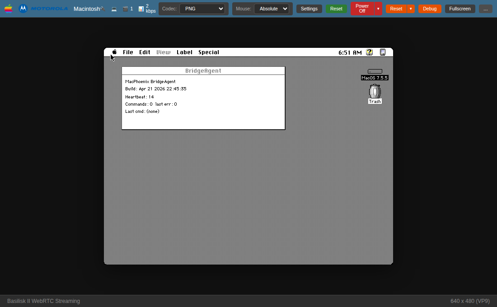

# MacPhoenix

Classic Macintosh software, System 6 through Mac OS 9, on a modern
computer. The repository holds two things:

* **MacPhoenix**: 68k and PowerPC Macs emulated from their ROMs, used from
  a web browser. One program serves the screen, sound, input and an
  automation API on one HTTP port.
* **Executor**: Mac applications on a Toolbox reimplemented in C++, with no
  ROM. It runs in a browser tab, as a desktop application on Linux and
  Windows, or inside MacPhoenix.

%20%7C%20MIT%20(most%20code)-blue)



## MacPhoenix: the ROM machines

MacPhoenix grew out of Basilisk II and SheepShaver. `--backend` picks the
machine, and with it the architecture; `--core` picks the CPU emulator.

| Backend | Machine | `--core` | Notes |
|---|---|---|---|
| `uae` (default) | 68k: Mac SE, IIci, Quadra 650 | `uae` (default), `mame-68k` | `--jit` for UAE's JIT |
| `kpx` | Power Mac G3 | `kpx` (default), `mame-ppc` | `--jit`: Kheperix's dyngen, or MAME's native x86-64/arm64 back-end |
| `executor` | none: Executor (below) | `mame-68k` | no ROM; PowerPC code on `mame-ppc` |

| Machine | ROM | Systems | Notes |
|---|---|---|---|
| Mac SE | Mac SE (256 KB) | System 6.0.8 | 512×342 mono, 4 MB |
| Mac IIci | IIci (512 KB) | System 6.0.8 | in colour, 8 MB |
| Quadra 650 | Quadra 650 (1 MB) | System 7.1, 7.5.5, Mac OS 7.6.1 | 7.1 runs with the IIci's machine type (`--model-id 5`) |
| Power Mac G3 | G3 (4 MB) | System 7.5.5, Mac OS 7.6.1, 8.6, 9.0.4 | |

The machine is worked out from the ROM. The web UI has a built-in profile
for each row (ROM, disks, RAM, screen, CPU core), shown when its ROM and
disk images are in storage. `--core kpx` maps guest memory at host
address 0 and needs `sudo sysctl vm.mmap_min_addr=0`; the other cores
don't. The move to MAME's cores: [docs/cpu/PLAN.md](docs/cpu/PLAN.md).

### Quick start

On Ubuntu 24.04 (other distributions and macOS: [docs/Install.md](docs/Install.md)):

```bash
sudo apt install build-essential cmake pkg-config git libssl-dev libyuv-dev qt6-base-dev \
    libopenh264-dev libvpx-dev libwebp-dev libopus-dev \
    cargo rustc hfsutils python3

git clone https://github.com/sirmick/mac-phoenix.git
cd mac-phoenix
cmake -B build
cmake --build build -j4

./build/mac-phoenix
```

Open **http://localhost:11000**, pick a profile or a ROM and disk under
Settings, and press Start. Or from the command line:

```bash
./build/mac-phoenix ~/storage/roms/quadra.rom --disk 7.5.5.img
./build/mac-phoenix --backend kpx --core mame-ppc --jit ~/storage/roms/g3.rom --disk 9.0.4.img --ram 128
```

The codecs, the Rust net-bridge (networking) and Executor are optional:
CMake skips what it can't find and says so.

### ROMs and disks

ROMs and Apple's system software aren't included. MacPhoenix looks for
them under `~/storage` (`--storage-dir`):

```
~/storage/
  roms/       ROM files, found by checksum
  images/     disk and CD images (.img, .dsk, .iso, .toast)
```

An existing Basilisk II or SheepShaver disk image works, and Settings →
Disk Images → New makes a blank HFS or HFS+ one. MacPhoenix can also build
images: [provisioning](docs/Provisioning.md) fetches pinned installers
(Apple's System releases, developer tools, games, productivity software),
runs each installer inside the guest, and assembles images such as
`7.5.5`, `9.0.4`, `dev-7.6.1` or `games` from the results.

### Using it

**Web UI.** Settings (machine, ROM, disks, RAM, screen, CPU core, sound,
network), Start / Shut Down / Restart, codec and mouse mode, fullscreen,
and a debug pane with the clipboard (synced both ways), logs and stats.
Changes are saved to `~/.config/mac-phoenix/config.json`.

**Transports.** The browser gets the screen over WebRTC (H.264/VP9), a
WebSocket (PNG/WebP) or HTTP long-poll, sound as Opus, and sends input
over the WebSocket: [docs/Deployment.md](docs/Deployment.md).

**API.** Everything the UI does, and more, is HTTP:

```bash
curl -s localhost:11000/api/status
curl -s localhost:11000/api/screenshot -o screen.png
curl -s -X POST localhost:11000/api/launch -d '{"path":"Macintosh HD:SimpleText"}'
curl -s -X POST localhost:11000/api/wait   -d '{"condition":"app=SimpleText","timeout":10}'
curl -s localhost:11000/api/ui             # the front application's windows, controls, menus
curl -s -X POST localhost:11000/api/shutdown
```

Reads (front application, windows, controls, text on screen) come straight
from guest memory. Actions (launch, scripts, copies, shut down) go through
BridgeAgent, an application the emulator starts inside the guest when
`--bridge` is on (and with `--headless-http`). That is enough to drive
installers and test suites unattended. Reference: [docs/API.md](docs/API.md),
protocol: [docs/CommandBridge.md](docs/CommandBridge.md).

**Networking.** `--network socket` gives the guest a NAT to the Internet
through `net-bridge` (DHCP, TCP, UDP, ICMP; no root) and puts every
running MacPhoenix on one Ethernet segment, so guests see each other over
IP and AppleTalk: [docs/Networking.md](docs/Networking.md).

**Development tools.** MPW and CodeWarrior's MPW tools run headless on
Executor (`tools/mpw/mpw build DIR`), which is how the guest test
applications are built: [docs/MPW.md](docs/MPW.md).

## Executor: no ROM

[Executor 2000](https://github.com/autc04/executor)'s Toolbox in C++,
grown here until Apple's own System 7.5–8.6 and Finder run on it, or
Executor's own small System with a launcher. 68k applications run on
MAME's 68000 core, PowerPC applications on MAME's PowerPC recompiler.
Because Executor is the Toolbox, it can draw text and window chrome again
at 2x from outlines while the program still sees a 72-dpi screen.

It lives in [executor/](executor/README.md), a product of its own. Its
documentation: [docs/executor/README.md](docs/executor/README.md).
**[executor/SHOWCASE.md](executor/SHOWCASE.md)** walks through Apple's free
System 7.5.3 and 18 freeware titles at 2x, on public downloads only.

It has three front ends.

**Desktop application** (`executor-desktop`, Qt 6 Widgets; built with
mac-phoenix above): Executor in-process, disks added and ejected live,
their changes kept in overlays (the images are never written).
[executor/frontends/desktop/README.md](executor/frontends/desktop/README.md).

```bash
./build/executor-desktop                                # Executor's own System
./build/executor-desktop --system ~/storage/web-library/boot-8.6.img --ppc   # Apple's 8.6
cmake --build build --target executor-desktop-appimage  # a Linux AppImage
tools/windows/build.sh && tools/windows/package.sh      # Windows zip, cross-built here
```

The Windows build fetches its toolchain (llvm-mingw, Qt 6.8) itself:
[tools/windows/README.txt](tools/windows/README.txt).

**Browser tab** (Executor compiled to WebAssembly, served by
`executor-standalone`, one Go program with the tab embedded): the server
keeps the library of disk images and every change the tab makes; the
first browser to open it has it until it stops.
[docs/executor/Standalone.md](docs/executor/Standalone.md).

```bash
source ~/emsdk/emsdk_env.sh                 # emsdk; Go 1.24 for the server
emcmake cmake -B build-wasm && cmake --build build-wasm -j4
make -C executor/server WASM_BUILD=$PWD/build-wasm
./executor/server/executor-standalone --open --images ~/Disks   # http://127.0.0.1:8090/
```

**Inside MacPhoenix** (`--backend executor`, or Executor in the web UI's
profiles): the same web UI and API as the ROM machines.

```bash
./build/mac-phoenix --backend executor
./build/mac-phoenix --backend executor --executor-system 7.5.5.img
```

## Building

What every part needs, and what is optional: [docs/Install.md](docs/Install.md).
In short: CMake, a C++ compiler, Qt 6 (≥ 6.4) and OpenSSL for mac-phoenix
and the desktop application; the codec libraries, Rust (net-bridge) and
Skia (`tools/skia/fetch.sh`, `-DEXECUTOR_SKIA=ON`, for Executor's 2x) if
wanted; emsdk and Go for the tab and its server; Retro68 only to rebuild
the guest-side applications, whose binaries are committed. Tests:
`ctest --test-dir build` ([docs/Testing.md](docs/Testing.md)).

## Documentation

| | |
|---|---|
| [docs/Install.md](docs/Install.md) | dependencies, optional parts, macOS, the guest-side apps' toolchain |
| [docs/API.md](docs/API.md) | every HTTP endpoint |
| [docs/Commands.md](docs/Commands.md), [docs/JsonConfig.md](docs/JsonConfig.md) | command line and config file |
| [docs/Deployment.md](docs/Deployment.md) | transports, ports, running behind a reverse proxy |
| [docs/Networking.md](docs/Networking.md) | net-bridge: NAT, DHCP, guest-to-guest, AppleTalk |
| [docs/Provisioning.md](docs/Provisioning.md) | building disk images from pinned installers |
| [executor/README.md](executor/README.md), [docs/executor/README.md](docs/executor/README.md) | Executor: the code, its origin and documentation |
| [docs/Testing.md](docs/Testing.md) | ctest suites, guest tests, Playwright |
| [docs/Packaging.md](docs/Packaging.md) | .deb / .rpm builds, Homebrew, Executor's packages |
| [docs/README.md](docs/README.md) | every document: architecture, subsystems, plans |

## Heritage

MacPhoenix descends from the Basilisk II / SheepShaver family created by
Christian Bauer (via [kanjitalk755/macemu](https://github.com/kanjitalk755/macemu)).
Executor is [Executor 2000](https://github.com/autc04/executor)
(Abacus Research & Development, Wolfgang Thaller); the MAME cores come from
[MAME](https://www.mamedev.org/).

## License

MacPhoenix as a whole is **GPL-2.0-or-later** ([LICENSE](LICENSE)): it
contains GPL code from UAE, Basilisk II and SheepShaver. Everything written
for MacPhoenix (the web server, WebRTC, browser UI, encoders, config,
CPU-core interface, net-bridge, BridgeAgent, provisioning, tools and tests)
is also **MIT** ([LICENSE-MIT](LICENSE-MIT)). Executor is MIT
([executor/COPYING](executor/COPYING)), and so are MacPhoenix's changes to
it and the rest of `executor/`: the front ends, the tab and its server
([executor/LICENSE-CONTRIBUTIONS](executor/LICENSE-CONTRIBUTIONS)). The
MAME CPU cores are BSD-3-Clause. File by file: [LICENSING.md](LICENSING.md).
