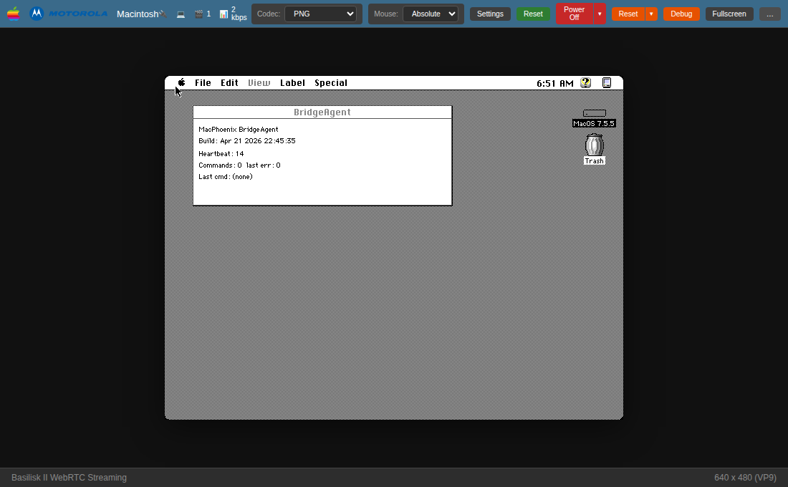

# MacPhoenix

A classic Macintosh emulator you use from a web browser. It runs System 6
through Mac OS 9 — 68k and PowerPC Macs from their ROMs, or classic
applications on a reimplemented Toolbox with no ROM at all — and serves
the screen, sound, input and an automation API from one HTTP port.

%20%7C%20MIT%20(most%20code)-blue)



## What it is

MacPhoenix grew out of the Basilisk II / SheepShaver emulators and has
three ways to run Mac software:

* **The 68k Mac** (`--backend uae`): a Mac SE, IIci or Quadra 650 from its
  ROM, on the UAE 68k core or MAME's 68000 core.
* **The PowerPC Mac** (`--backend kpx`): a Power Mac G3 from its ROM, on
  SheepShaver's Kheperix or MAME's PowerPC recompiler.
* **Executor** (`--backend executor`): Executor 2000's Toolbox in C++, with
  no ROM, grown here until Apple's own 7.5.5 Finder and System run on it;
  PowerPC applications run on MAME's PowerPC core
  ([docs/executor/README.md](docs/executor/README.md)).

The emulator is a headless server. The browser gets the screen over
WebRTC (H.264/VP9), a WebSocket (PNG/WebP) or HTTP; sound as Opus; input
the same way. A REST API reads the guest's state (front application,
windows, controls, the text on screen) and, through a small agent inside
the guest, launches applications, runs scripts, copies files and shuts down
cleanly — enough to drive installers and test suites unattended.

## What runs

| Machine | ROM | Systems | Notes |
|---|---|---|---|
| Mac SE | Mac SE (256 KB) | System 6.0.8 | 512×342 mono, 4 MB |
| Mac IIci | IIci (512 KB) | System 6.0.8 | in colour, 8 MB |
| Quadra 650 | Quadra 650 (1 MB) | System 7.1, 7.5.5, Mac OS 7.6.1 | 7.1 runs with the IIci's machine type (`--model-id 5`) |
| Power Mac G3 | G3 (4 MB) | System 7.5.5, Mac OS 7.6.1, 8.6, 9.0.4 | |
| Executor | none | Apple's System 7.5.5 with its Finder, or Executor's own | 68k applications; PowerPC-only applications on InterfaceLib (in progress) |

The machine is worked out from the ROM. The web UI has a built-in profile
for each row (ROM, disks, RAM, screen, CPU core), shown when its ROM and
disk images are in storage.

## Quick start

On Ubuntu 24.04 (other distributions and macOS: [docs/Install.md](docs/Install.md)):

```bash
sudo apt install build-essential cmake pkg-config git libssl-dev libyuv-dev qt6-base-dev \
    libopenh264-dev libvpx-dev libwebp-dev libopus-dev \
    cargo rustc hfsutils python3

git clone https://github.com/sirmick/mac-phoenix.git
cd mac-phoenix
cmake -B build
cmake --build build -j4

./build/mac-phoenix
```

Open **http://localhost:11000**, pick a profile or a ROM and disk under
Settings, and press Start. Or from the command line:

```bash
./build/mac-phoenix ~/storage/roms/quadra.rom --disk 7.5.5.img
./build/mac-phoenix --backend kpx --core mame-ppc --jit ~/storage/roms/g3.rom --disk 9.0.4.img --ram 128
./build/mac-phoenix --backend executor --executor-system 7.5.5.img
```

The codecs, the Rust net-bridge (networking) and the Executor backend are
optional: CMake skips what it can't find and says so.

## ROMs and disks

ROMs and Apple's system software aren't included. MacPhoenix looks for
them under `~/storage` (`--storage-dir`):

```
~/storage/
  roms/       ROM files, found by checksum
  images/     disk and CD images (.img, .dsk, .iso, .toast)
```

Disk images can come from anywhere: an existing Basilisk II / SheepShaver
image works, and Settings → Disk Images → New makes a blank HFS or HFS+
one. MacPhoenix can also build them: [provisioning](docs/Provisioning.md)
fetches pinned installers (Apple's System releases, developer tools, games,
productivity software), runs each installer inside the guest, and
assembles images such as `7.5.5`, `9.0.4`, `dev-7.6.1` or `games` from the
results.

## CPU backends and cores

`--backend` picks the machine and with it the architecture; `--core` picks
the CPU emulator.

| Backend | Arch | `--core` | Notes |
|---|---|---|---|
| `uae` (default) | 68k | `uae` (default), `mame-68k` | `--jit` for UAE's JIT |
| `kpx` | PowerPC | `kpx` (default), `mame-ppc` | `--jit`: Kheperix's dyngen, or MAME's native x86-64/arm64 back-end |
| `executor` | 68k (+ PowerPC applications) | `mame-68k` | no ROM; PowerPC code always on `mame-ppc` |

The `uae` and `kpx` cores map guest memory at host address 0, which needs `sudo sysctl vm.mmap_min_addr=0`; the MAME cores
don't. Plans and status: [docs/cpu/PLAN.md](docs/cpu/PLAN.md).

## Using it

**Web UI.** Settings (machine, ROM, disks, RAM, screen, CPU core, sound,
network), Start / Shut Down / Restart, codec and mouse mode, fullscreen,
and a debug pane with the clipboard (synced both ways), logs and stats.
Changes are saved to `~/.config/mac-phoenix/config.json`.

**API.** Everything the UI does, and more, is HTTP:

```bash
curl -s localhost:11000/api/status
curl -s localhost:11000/api/screenshot -o screen.png
curl -s -X POST localhost:11000/api/launch -d '{"path":"Macintosh HD:SimpleText"}'
curl -s -X POST localhost:11000/api/wait   -d '{"condition":"app=SimpleText","timeout":10}'
curl -s localhost:11000/api/ui             # the front application's windows, controls, menus
curl -s -X POST localhost:11000/api/shutdown
```

The guest-side commands go through BridgeAgent, an application the
emulator starts inside the guest when `--bridge` is on (and with
`--headless-http`). Reference: [docs/API.md](docs/API.md), protocol:
[docs/CommandBridge.md](docs/CommandBridge.md).

**Networking.** `--network socket` gives the guest a NAT to the Internet
through `net-bridge` (DHCP, TCP, UDP, ICMP; no root) and puts every
running MacPhoenix on one Ethernet segment, so guests see each other over
IP and AppleTalk: [docs/Networking.md](docs/Networking.md).

**Development tools.** MPW and CodeWarrior's MPW tools run headless on
Executor (`tools/mpw/mpw build DIR`), which is how the guest test
applications are built: [docs/MPW.md](docs/MPW.md).

## Documentation

| | |
|---|---|
| [docs/Install.md](docs/Install.md) | dependencies, optional parts, macOS, the guest-side apps' toolchain |
| [docs/API.md](docs/API.md) | every HTTP endpoint |
| [docs/Commands.md](docs/Commands.md), [docs/JsonConfig.md](docs/JsonConfig.md) | command line and config file |
| [docs/Deployment.md](docs/Deployment.md) | transports, ports, running behind a reverse proxy |
| [docs/Networking.md](docs/Networking.md) | net-bridge: NAT, DHCP, guest-to-guest, AppleTalk |
| [docs/Provisioning.md](docs/Provisioning.md) | building disk images from pinned installers |
| [docs/executor/README.md](docs/executor/README.md) | the Executor backend |
| [docs/Testing.md](docs/Testing.md) | ctest suites, guest tests, Playwright |
| [docs/Packaging.md](docs/Packaging.md) | .deb / .rpm builds, Homebrew |
| [docs/README.md](docs/README.md) | everything else: architecture, subsystems, plans |

## Heritage

MacPhoenix descends from the Basilisk II / SheepShaver family created by
Christian Bauer (via [kanjitalk755/macemu](https://github.com/kanjitalk755/macemu)).
Its Executor backend is [Executor 2000](https://github.com/autc04/executor)
(Abacus Research & Development, Wolfgang Thaller); its MAME cores come from
[MAME](https://www.mamedev.org/).

## License

MacPhoenix as a whole is **GPL-2.0-or-later** ([LICENSE](LICENSE)): it
contains GPL code from UAE, Basilisk II and SheepShaver. Everything written
for MacPhoenix — the web server, WebRTC, browser UI, encoders, config,
CPU-core interface, net-bridge, BridgeAgent, provisioning, tools and tests —
is also **MIT** ([LICENSE-MIT](LICENSE-MIT)). The Executor core is MIT,
including MacPhoenix's changes to it ([docs/executor/README.md](docs/executor/README.md)),
and the MAME CPU cores are BSD-3-Clause. File-by-file:
[LICENSING.md](LICENSING.md).
