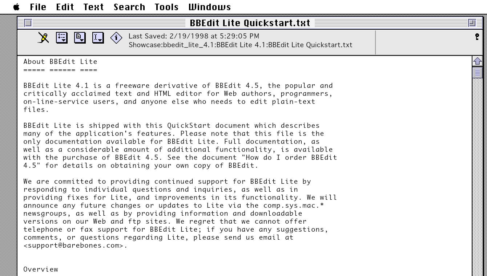
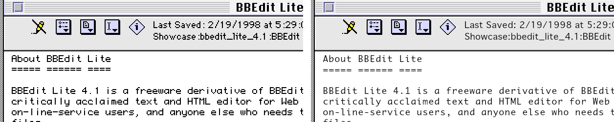
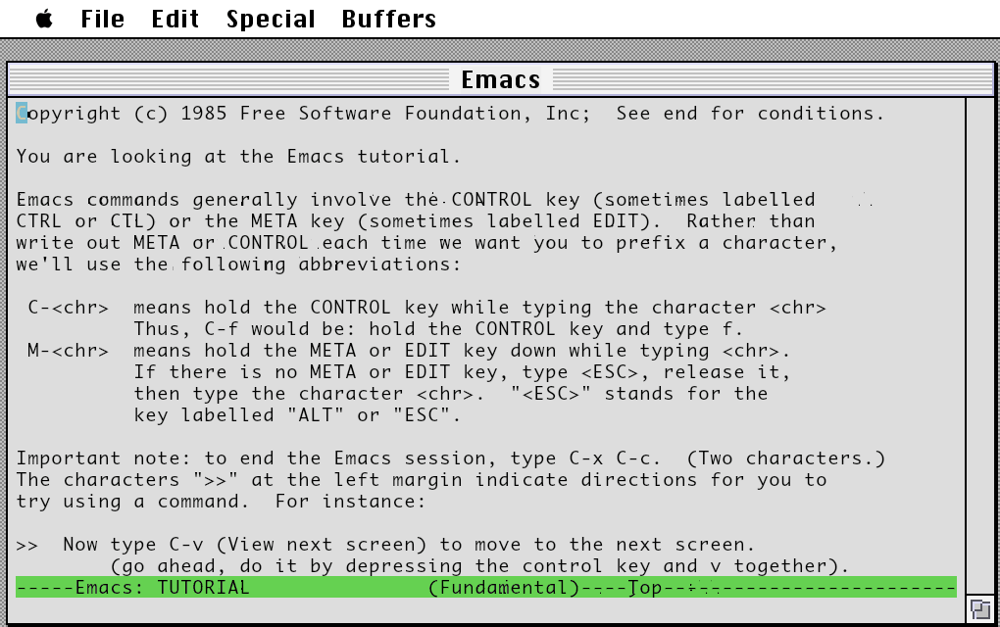
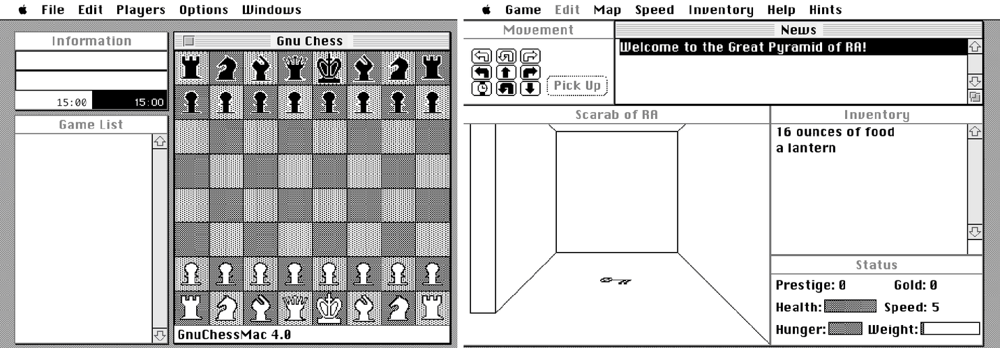
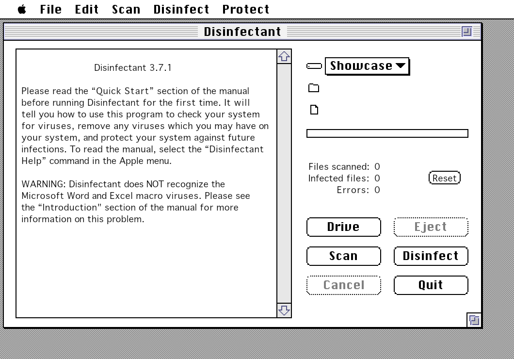

# Executor showcase: a classic Mac at 2x

Executor runs classic Macintosh software (68k, and PowerPC applications)
without a Mac ROM: the Toolbox is reimplemented in C++
([Executor 2000](https://github.com/autc04/executor), grown here until
Apple's own Systems and Finder run on it). Because Executor *is* the
Toolbox, it knows when a program draws text, a window frame or a scroll
bar, and can draw them again at twice the resolution from outlines, while
the program still sees its 1990s 72-dpi screen. Old Macs, sharp on a
modern display.



The same window at 1x (pixels doubled, left) and at 2x (Executor's
HiDPI, right):



Below: what to download (nothing of it is ours to give out, so every
item is a link to its public source, the Internet Archive, with
checksums), how to run it in the desktop application or in a browser,
and 18 freeware titles that run well and look good at 2x.

## 1. A System

Two choices; both run every title below.

**Nothing to download: Executor's own System.** Executor comes with a
small System of its own and a launcher in place of the Finder. It is what
the desktop application and the browser start with when no Apple System
is chosen.

**Apple's System 7.5.3 (recommended for the real Finder).** Apple gave
System 7.5.3 away as a free download; the Internet Archive keeps a
ready-installed 25 MB disk image of it:

| | |
|---|---|
| Item | <https://archive.org/details/AppleMacintoshSystem753> |
| File | [System7_5_3.img](https://archive.org/download/AppleMacintoshSystem753/System7_5_3.img) (26,214,400 bytes) |
| MD5 | `c7661911bbf3c56a77601ad53e139f62` |
| SHA-256 | `7a70976e590d464c3476c0b40500ae589f77604a26b1c8bd310cd4922233ec87` |

Apple's licence (shown by its installers) applies to Apple's software on
it. The image as published also carries HyperCard 2.4, which runs on
Executor too (it was not part of Apple's free download).

*Why not 7.5.5?* Apple's free
[System 7.5.5 Update](https://archive.org/details/system-7.5.5-update)
(four floppy images or one Net Install archive, for a 7.5.3 System) was
tried both ways. Installed on a Quadra 650 machine, the result runs the
same titles on Executor no better than 7.5.3 does. Inside Executor its
Installer stops Executor (known bugs, below), so updating would need a
real or emulated Mac. 7.5.3 as published is the simpler start.

## 2. The software disk

Download the archives in the table (section 5) into one folder, say
`~/Downloads/showcase`. They are StuffIt, BinHex and MacBinary files;
the Mac files inside have resource forks, which a plain unzip on Linux,
macOS or Windows would lose. Two ways that keep them:

**A disk image (desktop and browser).** With
[hfsutils](https://www.mars.org/home/rob/proj/hfs/) and
[unar](https://theunarchiver.com/command-line) installed (Debian/Ubuntu:
`apt install hfsutils unar`; macOS: `brew install hfsutils unar`), make a
blank HFS disk and let MacPhoenix's `provisioning/populate_disk.py`
expand every archive into it, forks and Finder information kept:

```bash
dd if=/dev/zero of=Showcase.img bs=1M count=80
hformat -l Showcase Showcase.img
python3 provisioning/populate_disk.py -i Showcase.img -s ~/Downloads/showcase
```

Each archive becomes a folder on the disk named after it
(`bbedit_lite_4.1`, `Emacs_1.1.7`, ...).

**Straight into Executor's own disk (desktop application only).** The
desktop application keeps Executor's own volume as a folder
(`~/.local/share/MacPhoenix/Executor/volumes/Executor/executor` on Linux,
`~/Library/Application Support/MacPhoenix/Executor/volumes/Executor/executor`
on macOS). Executor reads AppleDouble `._` files there as resource
forks, which `unar -k hidden` writes. Applications have no data fork,
and `unar` then writes only the `._` file, so give each one an empty
data file:

```bash
V=~/.local/share/MacPhoenix/Executor/volumes/Executor/executor
for a in ~/Downloads/showcase/*; do unar -q -k hidden -o "$V" "$a"; done
find "$V" -name '._*' | while read -r f; do
    b="$(dirname "$f")/$(basename "$f" | cut -c3-)"; [ -e "$b" ] || touch "$b"
done
```

## 3. The desktop application

`executor-desktop` (Qt 6; [its README](frontends/desktop/README.md)).
Build it with Skia for 2x:

```bash
tools/skia/fetch.sh                       # prebuilt Skia, once
cmake -B build -DEXECUTOR_SKIA=ON && cmake --build build -j4 --target executor-desktop
```

Run it on Apple's System with the software disk:

```bash
./build/executor-desktop --system System7_5_3.img --disk Showcase.img --scale 2
```

or with no arguments for Executor's own System. The same from the
window: **Disks > Add Image…** (or drop the `.img` on the window), tick
it to put it in; **Settings… > System** for Apple's System; the
**HiDPI** box in the tool bar for 2x. Disk images are never written:
the Mac's changes go to an overlay in the data folder.

## 4. In a browser

`executor-standalone` is one program with the browser tab inside
([docs/executor/Standalone.md](../docs/executor/Standalone.md)). Build
it (emsdk for the WebAssembly module, Go 1.24 for the server):

```bash
source ~/emsdk/emsdk_env.sh
emcmake cmake -B build-wasm -DEXECUTOR_SKIA=ON && cmake --build build-wasm -j4
make -C executor/server WASM_BUILD=$PWD/build-wasm
```

Put the images in a folder with a one-line record for the System disk
(its `tags` make the tab offer it as a System):

```bash
mkdir ~/MacDisks && cp System7_5_3.img Showcase.img ~/MacDisks/
echo '{"title":"System 7.5.3","tags":["system"]}' > ~/MacDisks/System7_5_3.img.json
executor/server/executor-standalone --images ~/MacDisks --open
```

In the tab: **Disks**, choose *System 7.5.3* as the System and tick
*Showcase*; **Settings > Display > Sharpness** 2 (or Auto, as sharp as the
display). Or all at once from the address:

```
http://127.0.0.1:8090/?disk=disks/System7_5_3.img&system=System7_5_3.img&disk=disks/Showcase.img&scale=2
```

The first browser to open the server owns it until it stops. The tab
fetches each disk once and keeps it; your changes are kept by the server.

## 5. The software

All tested on Executor with System 7.5.3 and with Executor's own System,
in the desktop application and in the tab (Chromium), at 2x. Everything
here is freeware, public domain, GPL, or shareware whose terms allow
free copying; each line says where that is written. None of it may be
sold. The links are into the Internet Archive's copy of the Macintosh
Garden collection. The MD5 is the Archive's own; SHA-256 is ours, of
the same file.

| Title | Author | Licence (where it says so) | Download | Shows off at 2x |
|---|---|---|---|---|
| **BBEdit Lite 4.1** (1998, fat) | Bare Bones Software | freeware: "BBEdit Lite is a freely distributable, copyrighted program ... BBEdit Lite cannot be sold" (*About BBEdit Lite*) | [bbedit_lite_4.1.sit](https://archive.org/download/Macintosh_Garden_Apps_B_2014/bbedit_lite_4.1.sit) MD5 `ce1baad73ebc814c3607b131d247f9f1` SHA-256 `1ac9619126955a9f57cddbb8eb455a3054cbdf5428f2efdb68cd39094e70846a` | a text editor: almost every pixel is text or chrome |
| **GNU Emacs 18.59** (Mac port 1.17, 1995) | Marc Parmet; FSF | GPL (*etc/COPYING*; sources at the port's FTP site, *About Emacs*) | [Emacs_1.1.7.sit](https://archive.org/download/Macintosh_Garden_Apps_E_2015/Emacs_1.1.7.sit) MD5 `ad7bbe2073206823a53bbf43abc7271a` SHA-256 `806ad989bc77720f39711e3fbc29651a3bbcc75542d9ef4693f430aba35c59f4` | a full-window Monaco editor, mode line, minibuffer (see known bugs) |
| **Easy View 2.61** (1995) | M. Akif Eyler | "can be distributed freely on any medium, for non-commercial purposes" (*Easy View Introduction*) | [easy-view-261.hqx](https://archive.org/download/Macintosh_Garden_Apps_E_2015/easy-view-261.hqx) MD5 `8e775395af97e719911335e38041d332` SHA-256 `2a9a897882bc405d7916f525f5e6c6fa58c3f3ad4f1bc0376febe912eb1689a5` | a reader for big structured text files; open its *Easy View Introduction* |
| **MathPad 2.5.2** (2000, 68k + PPC) | Mark Widholm | "MathPad is freeware. Selling it for profit without my permission is forbidden." (*README*) | [MathPad_2.5.2.bin](https://archive.org/download/Macintosh_Garden_Apps_M_2015/MathPad_2.5.2.bin) MD5 `fb1d46b9b8beaa07a929b27ae343e7ab` SHA-256 `5267ef34ff650901aa1eca2c66d5974b07d7b2f3577a91c10c9aaab07b090367` | a calculator you type as text, results inline |
| **UserLand Frontier 4.2.3** (1997, fat) | UserLand Software | "You may distribute the Frontier software, provided you distribute it in exactly the form distributed by UserLand" (the licence Frontier shows at first launch) | [Frontier_4.2.3.sit](https://archive.org/download/Macintosh_Garden_Apps_F_2019/Frontier_4.2.3.sit) MD5 `f14f0760f3c43b2cc56dac050158d58c` SHA-256 `0e4dac547d047fc3e5dbccd465a20337a66fc4637cec0d1b236fb42ae8670567` | outlines, scripts, the object database |
| **NIH Image 1.62** (1997, fat) | Wayne Rasband, NIH | "NIH Image is in the public domain." (About box) | [nih-image162_fat.hqx](https://archive.org/download/Macintosh_Garden_Apps_Collection_N/nih-image162_fat.hqx) MD5 `ca51d699dce50277f4196e7db940f853` SHA-256 `838e418fcee7e06b5ac781a211027c9e3c165b87a97fcd5f02bee1becb6f06f2` | dense tool palettes, LUT, results tables |
| **Disinfectant 3.7.1** (1997) | John Norstad, Northwestern University | "Permission is granted to make and distribute copies of this software ... may not, however, be sold" (About box) | [Disinfectant371.bin](https://archive.org/download/Macintosh_Garden_Apps_D_2014/Disinfectant371.bin) MD5 `c3fda98f146f8b2c272ba6f380a87816` SHA-256 `0f1f6ae3b7debe4dd4fb0484221ca1117da2e4ed1b0f49c7e65948752d276e5d` | the classic report window and its built-in manual |
| **SoundApp 2.4.3** (1997, fat) | Norman Franke | "SoundApp is Freeware ... may not be included in any for-profit software compilation" (*SoundApp Read Me*) | [SoundApp_Fat.sit_.hqx](https://archive.org/download/Macintosh_Garden_Apps_S_2017/SoundApp_Fat.sit_.hqx) MD5 `4c7d0738e3283a61a02bdc4a6484f0a0` SHA-256 `304ffbb8aee19c07913bd4466b9eb73b68b55932fd7630617ec2a88bc52447f4` | play lists and preferences dialogs; plays sound |
| **MacGzip 1.1.3** (1997, fat) | SPDsoft | "(c)SPDsoft 1993-95. ( FreeWare )", GNU gzip under the GPL (*GNU docs/COPYING*) | [MacGzip_FAT_1.1.3.sit_.hqx](https://archive.org/download/Macintosh_Garden_Apps_Collection_M/MacGzip_FAT_1.1.3.sit_.hqx) MD5 `5b6f51d4fec25514f6e44f5351bae0b4` SHA-256 `01cc3dc7689a55bbc0db2a199e93273732b566030281a1260b8bc96bd1ded56e` | its splash and preferences |
| **ZTerm 1.0.1** (1995, fat) | David P. Alverson | shareware: "may be redistributed non-commercially ... as long as all of the files are kept together and are unmodified" (*ZTerm Docs*) | [ZTerm1.0.1.sit](https://archive.org/download/Macintosh_Garden_Apps_Collection_Z/ZTerm1.0.1.sit) MD5 `9986dbefe34fc77541c70d0d95a99fed` SHA-256 `580bb55c49a1ae98ab160ea2a208d9f9578ee95b6c3f6bbf4c808f45ad983051` | a serial terminal |
| **NCSA Telnet 2.7b4** (1995, fat) | NCSA, University of Illinois | public domain: "The documentation, program and source code are in the public domain." (NCSA's *telnet.readme*) | [ncsa-telnet-27b4.hqx](https://archive.org/download/Macintosh_Garden_Apps_Collection_N/ncsa-telnet-27b4.hqx) MD5 `da13fe7ec7afd9c2f9bcb1907760c797` SHA-256 `2b19993e082278de2f52017f4d2b02918a5052e397eac034ba37e9fb2488147c` | a VT100 window of Monaco text (needs a network) |
| **BetterTelnet 2.0fc1** (1999, fat) | Rolf Braun et al. | GPL v2 (*telnet folder/COPYING*) | [bettertelnet-2.0fc1.sit_.bin](https://archive.org/download/Macintosh_Garden_Apps_B_2015/bettertelnet-2.0fc1.sit_.bin) MD5 `23271fb2a35fb9e8eefb5175694aae56` SHA-256 `c615f10214cd9d44ff4e3bb2c548200dddbbcdb497ad640e9a34e244de4c5fb3` | as NCSA Telnet, newer dialogs (needs a network) |
| **GnuChessMac 4.0** (1997, fat) | Dan Oetting, Tom Gerardy, Erich Oetting | "distributed under a GNU Public License and may be given away, but not sold" (*README*) | [gnu-chess-mac-40.sit](https://archive.org/download/Macintosh_Garden_Games_2020_G/gnu-chess-mac-40.sit) MD5 `32288234c1b5e030ce561d26a9262c90` SHA-256 `209d790cd7a930f35df2b856e34eb93df5167944ea1fdd8a50157cd74e9a0919` | board, clocks, move list |
| **GnuGo MacPack 0.5** (2001) | MacGnuGo's author; FSF | GPL (*COPYING*, Mac sources included) | [gnu-go-05.hqx](https://archive.org/download/Macintosh_Garden_Games_2019_G/gnu-go-05.hqx) MD5 `fe3c9c97b66c600aa77de90399773d0a` SHA-256 `650bfddebb912ff746a3ce63f2fab33f962c858ced3daa0bfab1725b06c293af` | GnuGo_anymac draws its board as text in a console |
| **Moria 1.1.1** (1994) | Richard Knuckey (Mac); R. A. Koeneke, J. E. Wilson | "may be copied and distributed for educational, research, and not for profit purposes" (About text) | [Moria.SIT](https://archive.org/download/Macintosh_Garden_Games_2014_M/Moria.SIT) MD5 `40a7783c07e6f1f09ba05cc2862a8427` SHA-256 `6eeef9805750029be54c85a05db0ff3486d190092a15dcc4148caf2a411390a1` | a roguelike in an 80×24 Monaco window |
| **Scarab of Ra 1.4** (1992) | Rick Holzgrafe | "may not be changed or resold for profit, but it may be freely distributed and copied" (About text) | [scarab_of_ra.sit](https://archive.org/download/Macintosh_Garden_Games_2014_S/scarab_of_ra.sit) MD5 `3f49dc2ad5e0be07581499710ad90550` SHA-256 `36795015faef9b07315fff5d4ad2c07e1008b1808dfa0d364d007d432ee8782e` | a line-drawn 3D maze with text panels |
| **Bolo 0.99.7** (1995) | Stuart Cheshire | "Shareware for non-commercial use ... You can also give copies to your friends, but you mustn't charge them money" (*README FIRST*) | [bolo-0997.hqx](https://archive.org/download/Macintosh_Garden_Games_2014_B/bolo-0997.hqx) MD5 `ab21bb0b8e6339fa49bec777c3cfba59` SHA-256 `809e73afe53ba0600b54e42553d50bc830f88eb499186374cf1299dc47278d88` | the famous tank game's panels and dialogs |
| **Continuum 1.03** (1987–93) | Randall and Brian Wilson | "Beerware": "You may copy it freely and give it to anyone, as long as it is not modified or sold." (About text) | [Continuum.sit](https://archive.org/download/Macintosh_Garden_Games_2014_C/Continuum.sit) MD5 `7395c2dcf3f00f22647d6a211af17cc8` SHA-256 `b0e548e67dc749da02872d9c06a961f23e3bc4a134c9aa1a1615f06711bdd333` | a Gravitar-style game; title and scores |







## 6. Known bugs

- **Pictures stay 1x.** Text, frames, controls and menus are drawn again
  at 2x; a program's own bitmaps (icons, game playfields, splash screens)
  are scaled up. Text a program draws a character at a time and then
  scrolls can leave 1x specks (Emacs's first-run console).
- **GNU Emacs** needs the Mac's memory at 32 MB or less (Settings >
  Memory, or `--ram 24`): with more it starts a helper, *Emacs
  Positioner*, which Executor fails to launch (error -50). Its first run
  writes into its own file and quits; start it again. Continue past the
  warning about its *Emacs Keyboard* extension.
- **Apple's 7.5.5 Update Installer** stops Executor: right after its
  licence dialog it calls `InitWindows`, which empties Executor's window
  list, and the next `ModalDialog` has no window (a host crash).
- **Applications from before System 7** ignore the Quit Apple event; quit
  them from their File menu.
- **The telnet programs** need a network: the desktop application uses
  the host's; the tab, the server's relay.
- Some programs open no window until asked: open a document (Easy View),
  or start a game or session from their menus (Moria, MacGnuGo, the
  telnet programs).
- Not here, and why: TurboGopher 2.0.3 says it finds neither MacTCP nor
  Open Transport; programs in the Archive's copies as disk images inside
  archives (Arashi, Xconq, StuffIt Expander 4) need an extra step;
  programs whose licence is unclear or forbids copying (JPEGView,
  MacSokoban on large media, Acta Classic, Glider, Tetris Max and others)
  were left out.

## How this was tested

Every title was launched, one Executor session each, in mac-phoenix
(`--backend executor --executor-scale 2`, on System 7.5.3, on 7.5.3
updated to 7.5.5, and on Executor's own System), in `executor-desktop`
(`--request "launch PATH" --screenshot`) and in the tab through
`executor-standalone` with Playwright:
`node executor/tests/web/showcase_tab.mjs DIR IMAGES SHOTS System7_5_3.img "name|Mac path"...`
(Executor 2026-11-07, wash/showcase).
